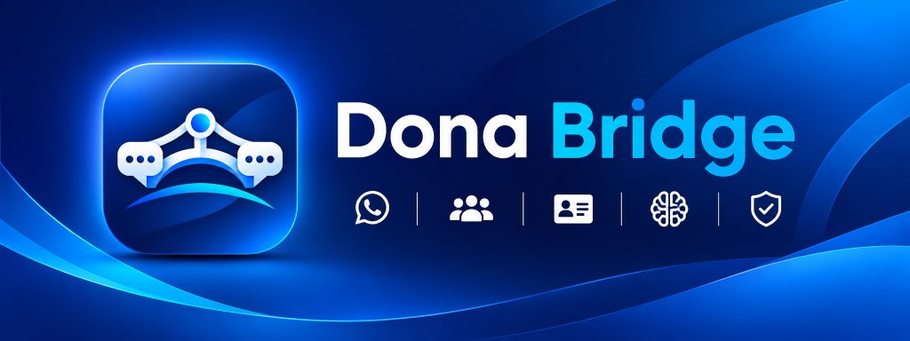

<div align="center">



# Dona Bridge

**Multi-session web messaging workspace for Windows — with a local CRM, draft-only writing assistant, and local MCP server.**

[](LICENSE)
[-0078D6.svg)](#download--install)
[](https://github.com/ma-kahar/dona-bridge/releases)

> **Legal & Trademark Notice:** Dona Bridge is an independent, open-source project developed by Donatek. It is **not** affiliated with, endorsed by, sponsored by, or officially connected with WhatsApp LLC or Meta Platforms, Inc. "WhatsApp" is a registered trademark of WhatsApp LLC. Dona Bridge simply hosts standard web sessions inside Microsoft Edge WebView2 like a multi-tab browser.

</div>

---

## Download & Install (Windows)

### Option 1 — Windows Installer (Pre-release v0.1.0)

1. Go to the [**Latest Release**](https://github.com/ma-kahar/dona-bridge/releases/latest) page.
2. Download **`Dona Bridge_0.1.0_x64-setup.exe`**.
3. Double-click the installer to install per-user (no administrator rights required).
4. Launch **Dona Bridge** from the Start Menu and click **+ Add account** to sign in via QR code.

> **Windows SmartScreen Notice (v0.1.0):** Initial pre-release builds are unsigned while free open-source Authenticode signing via [SignPath Foundation](https://signpath.org/) is being onboarded. If Windows Defender SmartScreen displays *"Windows protected your PC"*, click **More info → Run anyway** (or verify the build by compiling from source below).

> **System Requirements:** Windows 10 (22H2+) or Windows 11 (64-bit). Microsoft Edge WebView2 Runtime is bootstrapped automatically if not already present.

### Option 2 — Winget *(planned after signed release)*

```powershell
winget install Donatek.DonaBridge
```

---

## Key Features

| Area | What you get |
|---|---|
| **Multi-Session Dock** | Run multiple personal and business web messaging sessions side by side in isolated WebView2 data directories, with live unread badges and `Ctrl+1`–`9` switching. |
| **Local-First CRM** | Manage contacts (with E.164 phone normalization), pipeline stages (`New`, `Follow-up`, `Negotiating`, `Won`, `Do not contact`), notes, follow-up reminders, and UTF-8 CSV export. |
| **Quick-Reply Templates** | Save reusable message templates and insert them as drafts into the active composer (`Ctrl+B` toggles the CRM drawer). |
| **Draft-Only Writing Assistant** | Supports local **Ollama** (offline & free) as well as cloud AI providers (explicit consent required before any cloud request). Reads the open chat only on click and **never sends messages automatically**. |
| **Hardened Local MCP Server** | Optional JSON-RPC server on `127.0.0.1:39420` (plus `dona-bridge-mcp.exe` stdio bridge) with 256-bit bearer token, `Origin`/`Host` validation, rate limiting, and contact-checked draft insertion. |
| **Security & Privacy** | App Lock via **Argon2id PIN** or **Windows Hello**, API keys stored exclusively in **Windows Credential Manager**, SQLite WAL storage, and zero telemetry. |
| **Multilingual UI** | Full interface in **English**, **Français**, and **বাংলা (Bangla)**. |

---

## Acceptable Use & Compliance

Dona Bridge is designed strictly as a human-operated multi-session browser container:

- **Human-in-the-loop only:** No code presses Send, clicks Send, or simulates keyboard `Enter` in any message composer.
- **No protocol emulation:** Never uses unofficial protocol libraries or reverse-engineered clients; loads standard `https://web.whatsapp.com` inside WebView2.
- **No background scraping:** Open chat context is read only when you explicitly click **Read open chat**, limited to the last 20 messages in memory.
- **No bulk, broadcast, or auto-reply:** Permanently out of scope. For high-volume business messaging, use [Meta's official WhatsApp Business Platform](https://business.whatsapp.com/).

---

## Architecture & Tech Stack

- **Desktop Core:** [Tauri v2](https://v2.tauri.app/) + Rust (`dona-core`, `dona-bridge`, `dona-bridge-mcp`)
- **Frontend:** React 18 · TypeScript · Tailwind CSS · Zustand · `react-i18next`
- **Database:** Local SQLite (`dona.db`) in WAL mode with numbered migrations
- **Secrets:** Windows Credential Manager (`keyring`)

### Local Data Paths (Windows)

- App data & CRM database: `%APPDATA%\com.makahar.donabridge\`
- Isolated WebView2 sessions: `%LOCALAPPDATA%\com.makahar.donabridge\WebView2\`

---

## Build from Source

### Prerequisites

- **Windows 10 / 11** (x64)
- **Rust** (stable toolchain)
- **Node.js 20+** and **pnpm**
- **Microsoft Edge WebView2 Runtime**

### Commands

```powershell
# Install frontend dependencies
pnpm install

# Run in development mode
pnpm tauri dev

# Build the Windows NSIS installer (.exe)
pnpm tauri build
```

### Run Tests & Checks

```powershell
cargo fmt --check
cargo clippy --workspace -- -D warnings
cargo test --workspace

pnpm lint
pnpm typecheck
pnpm test
```

---

## Contributing & Security

- Read [CONTRIBUTING.md](CONTRIBUTING.md) before opening a pull request.
- Report security issues privately via [SECURITY.md](SECURITY.md).
- See [PRIVACY.md](PRIVACY.md) for local-first and GDPR details.

## License

MIT © [Donatek](https://github.com/ma-kahar) & Dona Bridge Contributors — see [LICENSE](LICENSE).
